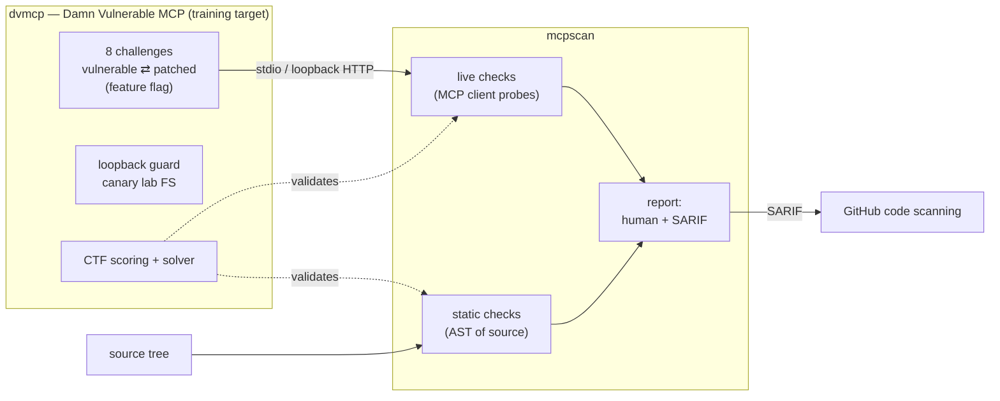

# mcp-range

**A deliberately vulnerable MCP server (`dvmcp`) paired with a static + live MCP
vulnerability scanner (`mcpscan`).** Built to teach — and to detect — the
vulnerability classes that showed up across real 2026 Model Context Protocol
CVEs, mapped to the OWASP Top 10 for Agentic Applications (ASI) and the OWASP
MCP Top 10.

> ⚠️ **`dvmcp` is intentionally vulnerable.** It is a training target. Never
> expose it to a network you do not fully control. Every "secret" in it is a
> fake canary. See [SECURITY.md](SECURITY.md).

---

## Why this exists

MCP connects AI agents to tools, resources and prompts. That new surface has
two kinds of risk, and `mcp-range` covers both:

- **Classic web bugs reached through a tool call** — path traversal, SSRF,
  command injection, missing auth. Most 2026 MCP CVEs are exactly this.
- **MCP-native bugs** — tool poisoning (hidden instructions in a tool
  description the model trusts), rug pulls (a tool that mutates after approval),
  and prompt-injection-to-tool-call chains.

`dvmcp` plants one of each so you can exploit it, then diff the fix. `mcpscan`
finds them — first in source, then against a running server — and reports in
SARIF so findings land in GitHub code scanning. The scanner is validated
against the server: because we know exactly which 8 bugs were planted, the
true-positive rate is measured, not asserted.

## Detection results (from a real run — `python scripts/validate.py`)

| Check | Result |
|-------|--------|
| Challenges exploitable (vulnerable build) | **8/8** |
| Challenges exploitable (patched build) | **0/8** |
| Static scanner — challenge modules flagged | **8/8 (100%)** |
| Live scanner — vulnerability categories detected | **8/8 (100%)** |
| False positives against the patched build | **0** |

These numbers are produced by `scripts/validate.py` on every CI run; the build
fails if detection regresses.

## Architecture



## Quickstart

```bash
pip install .            # or: pip install .[dev] to run the tests

# --- dvmcp (the target) ---
dvmcp list                       # the challenge catalogue
dvmcp                            # serve over stdio (default, safest)
dvmcp --transport streamable-http --port 8731   # loopback HTTP
dvmcp solve                      # run every exploit, confirm 8/8
dvmcp --patched solve            # patched build: 0/8

# run the whole range in Docker (host-loopback only)
docker compose up --build

# --- mcpscan (the scanner) ---
mcpscan static dvmcp                         # scan source, human-readable
mcpscan --sarif out.sarif static dvmcp       # + SARIF for code scanning
mcpscan --fail-on high static path/to/server # CI gate
mcpscan live --url http://127.0.0.1:8731/mcp # probe a running server
mcpscan live --stdio "dvmcp"                 # launch + probe over stdio
```

## The 8 challenges

Each challenge ships a vulnerable implementation, a patched version behind the
`--patched` flag, and a documented exploit in [`docs/challenges/`](docs/challenges/).

| # | Challenge | OWASP MCP | OWASP ASI | CWE | Difficulty |
|---|-----------|-----------|-----------|-----|-----------|
| c01 | [Tool poisoning](docs/challenges/c01-tool-poisoning.md) | MCP03 | ASI01 | CWE-1384 | Easy |
| c02 | [Rug pull](docs/challenges/c02-rug-pull.md) | MCP03 | ASI04 | CWE-494 | Medium |
| c03 | [Path traversal](docs/challenges/c03-path-traversal.md) | MCP05 | ASI02 | CWE-22 | Easy |
| c04 | [SSRF](docs/challenges/c04-ssrf.md) | MCP05 | ASI02 | CWE-918 | Medium |
| c05 | [Command injection](docs/challenges/c05-command-injection.md) | MCP05 | ASI05 | CWE-78 | Medium |
| c06 | [Missing authentication](docs/challenges/c06-missing-auth.md) | MCP07 | ASI03 | CWE-306 | Easy |
| c07 | [Prompt-injection → tool-call chain](docs/challenges/c07-prompt-injection-chain.md) | MCP06 | ASI01 | CWE-77 | Hard |
| c08 | [Secrets exposure (resource)](docs/challenges/c08-secrets-exposure.md) | MCP01 | ASI03 | CWE-538 | Medium |

Taxonomy and CVE grounding for each class is in [NOTES.md](NOTES.md).

## What `mcpscan` checks

**Static (AST of source):** `shell=True` / `os.system` / `eval`/`exec` sinks;
file reads on parameter-derived paths without a containment guard; user-URL
fetches without destination validation; sensitive tools with no authorization;
secret-shaped fields returned from resources; poisoned tool descriptions
(including invisible/BiDi characters); and runtime tool re-registration
(rug-pull). Supports inline `# mcpscan: ignore[RULE]` suppression.

**Live (MCP client):** enumerates tools and resources; flags poisoned
descriptions and secret-shaped resource content; and runs **safe canary
probes** — traversal reads, SSRF to internal/metadata canaries, a harmless
`echo` command-injection marker, an unauthenticated call to sensitive tools,
tool-output that reads as instructions, and a before/after description diff for
rug pulls. No probe writes, deletes, or exfiltrates real data.

Every finding carries a severity, its ASI/MCP/CWE mapping, and a remediation
note. Rule catalogue: [`mcpscan/findings.py`](mcpscan/findings.py).

## Development

```bash
pip install .[dev]
pytest -q                 # 50 tests
python scripts/validate.py
```

Module layout: `dvmcp/` (server, challenges, solver, scoring, safety),
`mcpscan/` (`static/`, `live/`, `sarif.py`, `findings.py`, `heuristics.py`),
`docs/challenges/`, `tests/`.

## License

Apache-2.0. See [LICENSE](LICENSE).
